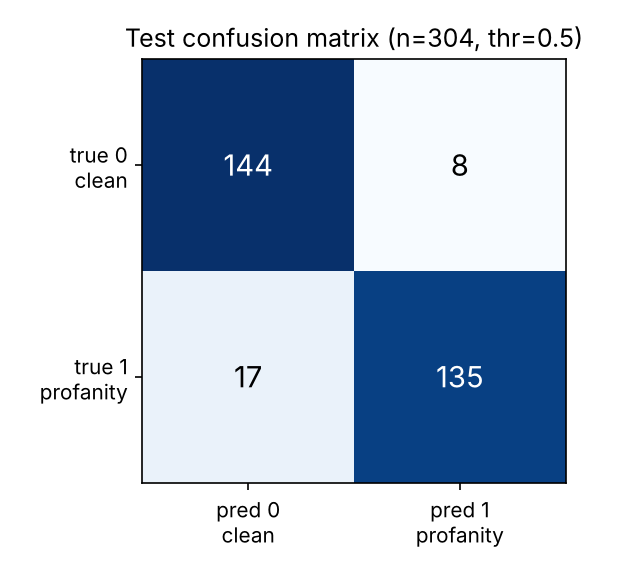

# Kazakh Profanity Detection in Product Reviews

DSSC5113 bonus project. A small trained model reads one Kazakh review or comment and predicts:

* **0** = no Kazakh profanity
* **1** = Kazakh profanity present

It also shows the **probability of profanity** next to the label.

**Model:** character n-gram TF-IDF + logistic regression, trained from scratch (scikit-learn).
**Test result (304 held-out comments):** precision **0.944**, recall **0.888**, F1 **0.915** for the profanity class.

---

## 1. Quick start

Python 3.12 or newer. On Windows use `py` instead of `python`.

```bash
git clone <this-repo-url>
cd kazakh-profanity-detection
python -m pip install -r requirements.txt

# predict with the saved model (no training needed)
python -m src.predict "Жеткізу тез болды, сапасы жақсы, рахмет!"
python -m src.predict "Kotakbas dukan" --explain      # also shows which n-grams decided
python -m src.predict                                   # interactive: type comments, empty line to quit
```

From Python or a notebook:

```python
from src.predict import predict
predict(["Сапасы өте нашар екен", "мал ойын"])
# [{'text': 'Сапасы өте нашар екен', 'label': 0, 'prob_profanity': ...}, {'text': 'мал ойын', 'label': 1, ...}]
```

Google Colab: open `notebooks/kazakh_profanity_colab.ipynb`, set `REPO_URL` in the first code cell and run all cells.

### Reproduce everything

```bash
python -m src.prepare_data   # needs data/raw/kazakh_profanity_share.xlsx (see section 3); writes data/processed/*
python -m src.train          # settings search on validation, saves models/
python -m src.evaluate       # one evaluation on the test set, writes results/
```

The processed splits are already in the repository, so `src.train` and `src.evaluate` run without the raw file.
All settings and the random seed (**42**) are in `config.json`. Everything is deterministic: rerunning gives the same splits, model and numbers.

## 2. Repository layout

| Path | What it is |
|---|---|
| `config.json` | seed, split settings, settings searched on validation |
| `src/text_normalization.py` | fixed (not learned) text normalization |
| `src/prepare_data.py` | cleaning, label corrections, de-duplication, splits |
| `src/model.py` | the pipeline, save/load, explanation of a prediction |
| `src/train.py` | validation search, threshold choice, saves the model |
| `src/evaluate.py` | single test evaluation, metrics, confusion matrix |
| `src/predict.py` | command line / Python prediction on new text |
| `data/label_corrections.csv` | the 8 labels we changed, with reasons |
| `data/processed/{train,val,test}.csv` | final splits (PII scrubbed) |
| `data/processed/near_duplicate_pairs.csv` | near-duplicate pairs that were kept in one split |
| `models/profanity_pipeline.joblib` | trained model **including** the normalizer and TF-IDF vocabulary (≈270 KB) |
| `models/model_meta.json` | chosen settings, threshold, package versions |
| `results/` | `data_stats.json`, `val_search.csv`, `val_threshold_curve.csv`, `test_metrics.json`, `confusion_matrix.png`, `test_predictions.csv` |
| `notebooks/kazakh_profanity_colab.ipynb` | runs the whole thing in a fresh Colab |

## 3. Dataset

### Source and access

* Texts come from **KazSAnDRA** (Kazakh Sentiment Analysis Dataset of Reviews and Attitudes, ISSAI, Nazarbayev University; 180,064 Kazakh reviews, CC BY 4.0):
  <https://huggingface.co/datasets/issai/kazsandra>, <https://github.com/IS2AI/KazSAnDRA>.
* The profanity labels come from the course file `kazakh_profanity_share.xlsx` (shared by the instructor on Teams): 3,061 KazSAnDRA reviews with columns `kazsandra_id, text, label, split`. Put it at `data/raw/kazakh_profanity_share.xlsx` to rerun `src.prepare_data`. The raw file is not committed (it has a few unscrubbed user handles); the scrubbed splits are.
* KazSAnDRA's original labels are **sentiment** scores (1–5). They do not match this task (a 1-star review is often angry but clean), so they are **not used**. Only the binary profanity labels are used, after our own check (below).

### How it relates to Kazakh product reviews

All texts are real user reviews of products and services written in Kazakh (often mixed with Russian). The `kazsandra_id` prefix shows the platform (our reading of the prefixes): `pla` = app-store reviews (2,702), `kas` = marketplace product reviews (183), `gis` / `map` = reviews of places in map services (95), `kit` / `fli` = book / online-store reviews (59). Most rows are app reviews, so the model sees much more gaming / app vocabulary than goods vocabulary — see Limitations.

### Size and class distribution

| | rows | label 0 | label 1 |
|---|---|---|---|
| raw file | 3,061 | 1,523 | 1,538 |
| after cleaning (8 label fixes, 22 duplicates removed) | **3,039** | **1,519** | **1,520** |

No synthetic examples are in train / val / test. The 8 hand-written comments in section 7 are synthetic and are used only as a demo.

### Labeling rules

A comment is **1** if it contains at least one of:

1. Kazakh obscene / vulgar words, including body and sexual vulgarisms and their compounds (e.g. *қотақ, қотақбас, ам, шешеңнің амы, сігейін, көтіңді, жәлеп*).
2. Russian obscene words used inside a Kazakh comment (*бля, нахуй, пиздец, заебал, сука, говно* …). **Mixed-language rule:** the comment must be (mostly) Kazakh; the profane word may be Kazakh or Russian, Cyrillic or Latin.
3. Abusive insults that work as swearing in Kazakh online speech and are consistently labeled 1 in this data: *мал* (as an insult, "cattle"), *есек / ешек* ("donkey"), *далбаёб, тупой, чорт*.

A comment is **0** when:

* it is negative but has no profane word ("Сапасы нашар", "Жамаан ойын" = bad game). **A negative review is not automatically profane.**
* a profane-looking string is used literally or is part of another word: *мал* = livestock ("мал шаруашылығы", "Мал сататын жер"), *Ассалаумағалейкум*, *маломерка*, *қатынайды* (commutes).
* it only talks about swearing without swearing ("Боқтаудыда … үйрендік" = we learned swearing …).

**Masked words** (`п*здец`, `с**ка`, `бл**`, `Ш*******`) count as profanity if the masked word is clearly recognizable: the writer still intends the word.
**Spelling variations** (Latin script `qotaq`, `pizdez`; missing Kazakh letters `котак`; elongation `Қотаааақ`; joined/split words `котак бас`) are labeled the same as the standard spelling.
**Ambiguous cases** (unclear abbreviations, a vulgar word possibly used as a name, e.g. "Менің атым Ам") keep the original label; we did not guess.

### Label check and corrections

We checked that the given labels match the rules above. Method: (a) list every label-0 comment that contains a known profane root, (b) list label-1 comments that contain none, (c) read them and compare with how the same word is labeled elsewhere in the data. We changed **8 labels** (6 × 0→1, 2 × 1→0); every change and its reason is in `data/label_corrections.csv`. Examples: "Қотақбас екен" 0→1 (clear profanity); "Маған осы амок ас ұнайды" 1→0 (*амок ас* = the game *Among Us*, not the vulgar word *ам*).

### Labeled examples

| text | label | why |
|---|---|---|
| Сапасы жақсы. Мөлшері маломерка екен. Бір-екі размер үлкендеу қылып алыңдар. | 0 | product review, clean |
| Жамаан ойын | 0 | negative but no profanity |
| Мал сататын жерекен сатып алатын емес бағалары сұмдыққо. | 0 | *мал* = livestock |
| Боқтаудыда, Иманды болудыда ттдан үйрендікқо | 0 | mentions swearing, does not swear |
| Кымбаттап кетипти говно | 1 | Kazakh comment + Russian obscene word |
| Pizdez oyin | 1 | Latin script |
| Бл\*ть за\*б\*л ката береды … | 1 | masked words |
| Редми мал кампаниасы | 1 | *мал* as an insult |
| Рақмет котакбас | 1 | polite word + profanity is still profanity |

### Personal information

E-mails, URLs, phone numbers and user handles are replaced by `<EMAIL>`, `<URL>`, `<PHONE>`, `@user` (KazSAnDRA had already replaced most handles with `@user`; 2 rows needed scrubbing). No reviewer names or IDs other than the public KazSAnDRA review id are stored. Review texts can still mention first names inside the text (e.g. addressing another user); we did not try to remove those automatically.

## 4. Splits

1. **Exact duplicates** removed after normalization (case, punctuation, elongation ignored): 22 rows ("Котен" / ".котен").
2. **Near-duplicates** grouped: two comments are near-duplicates if the Jaccard similarity of their character 3-gram sets is ≥ 0.6 (e.g. "мал ойын" / "мал ойын12", "Пиздец ойын ғо" / "пиздец ойын"). 307 pairs → 67 groups, 279 rows. A group always stays in **one** split (`assert` in the code). We did **not** reuse the `split` column of the shared file because it puts such near-duplicates in different splits (36 of our near-duplicate groups, 196 rows, span more than one of its splits).
3. **Split:** `StratifiedGroupKFold(n_splits=10, shuffle=True, random_state=42)` — one fold = test, one fold = validation, eight folds = train; stratified by label, grouped by near-duplicate group.

| split | rows | label 0 | label 1 |
|---|---|---|---|
| train | 2,431 | 1,215 | 1,216 |
| validation | 304 | 152 | 152 |
| test | 304 | 152 | 152 |

The TF-IDF vocabulary and IDF weights are fitted on **train only** (they are inside the pipeline that is `.fit()` on train). The normalization is fixed rules, nothing is learned from data.

## 5. Model

### Why this model

* Profanity is mostly a **lexical** signal: a few words decide the label. A linear model over character n-grams captures that well and is fast (training < 1 s on a laptop CPU).
* **Character** n-grams (not whole words) handle Kazakh morphology and messy spelling: *қотақбас, қотақбастар, котакбастарски* share the n-grams `котак`, `отакб`, …; a word never seen in training still gets a score from its parts. Kazakh is agglutinative, so a word-level vocabulary would miss most inflected forms.
* Logistic regression gives a probability and its weights are readable, so every prediction can be explained (`--explain`).
* Small data (2.4k training comments) — a large transformer would need a GPU and is harder to inspect; it is a possible improvement (section 9).

### How a comment becomes model input (trace of one example)

```
raw:         "Kotakbas dukan, aqshamdy qaitaryndar!!!"
1 normalize: "котакбас дукан акшамди каитариндар"
             lower-case -> Latin to Cyrillic (q->к, sh->ш, y->и, …) -> fold Kazakh letters (қ->к, ғ->г, ң->н, ә->а, ө->о, ұ/ү->у, і/ы/й->и)
             -> masks "**" -> "*" -> punctuation -> spaces -> "ааааа" -> "а"
2 n-grams:   char_wb 3..5 inside each word, padded with spaces: " ко", "кот", "ота", …, "котак", …
3 TF-IDF:    a sparse vector of 18,872 numbers, 77 of them non-zero for this comment
             (sublinear tf, IDF learned on train, L2-normalized)
4 score:     z = b + Σ wᵢ·xᵢ = −0.859 + 5.282 = +4.423
5 prob:      sigmoid(z) = 0.988  ≥ threshold 0.5  ->  label 1
             biggest contributions: ' кот' +0.38, 'кота' +0.27, 'котак' +0.25, …
```

### Long comments, punctuation, unknown words

* **Long comments:** no truncation; every n-gram is counted. Because the vector is L2-normalized, one profane word inside a very long comment gets a small weight — this causes some misses (section 8, case 5).
* **Punctuation:** replaced by spaces (so "ойын.Өте" becomes two words); `*`, `#`, `$`, `%` are kept as a single `*` because they mark masked letters; emoji are kept as characters.
* **Unknown words / tokens:** there is no "unknown token" — any new word is split into character n-grams; n-grams not in the training vocabulary are ignored, the known ones still count. N-grams seen in fewer than 2 training comments are dropped (`min_df=2`) to reduce noise.

### Training settings

| setting | value |
|---|---|
| vectorizer | `TfidfVectorizer(analyzer="char_wb", ngram_range=(3,5), min_df=2, sublinear_tf=True)` |
| classifier | `LogisticRegression(C=5, solver="liblinear", max_iter=5000)`, L2 penalty |
| objective | binary cross-entropy (log-loss) + L2 regularization; `C` = inverse regularization strength |
| class weights | none (train set is 50/50) |
| decision threshold | 0.5 (chosen on validation) |
| seed | 42 |
| packages | `requirements.txt` (scikit-learn 1.9.1, numpy 2.5.3, pandas 3.0.5, …) |

### Choosing settings on validation

36 candidates were trained on train and scored on validation (`results/val_search.csv`): normalization on/off × n-gram range {(2,4), (2,5), (3,5)} × C {0.5, 1, 2, 5, 10, 20}. Selection rule: highest validation F1 for class 1, ties → higher average precision → smaller C.

| best run | val precision | val recall | val F1 |
|---|---|---|---|
| **with normalization**, (3,5), C=5 — chosen | 0.979 | 0.941 | **0.960** |
| without normalization, (3,5), C=1 | — | — | 0.938 |

The threshold was then swept from 0.05 to 0.95 on validation (`results/val_threshold_curve.csv`); 0.5 gave the best F1. Lower thresholds trade precision for recall (val: 0.4 → P 0.935 / R 0.947; 0.3 → P 0.852 / R 0.987).

## 6. Test results (evaluated once, after all choices were fixed)

304 test comments (152 clean, 152 profane), threshold 0.5:

| class 1 (profanity) | value |
|---|---|
| precision | **0.944** |
| recall | **0.888** |
| F1 | **0.915** |
| accuracy (both classes) | 0.918 |



| | predicted 0 | predicted 1 |
|---|---|---|
| **true 0** | TN = 144 | FP = 8 |
| **true 1** | FN = 17 | TP = 135 |

Test F1 is lower than validation F1 (0.915 vs 0.960). This is expected: settings were picked to be best on validation, and with ~150 comments per class one comment changes recall by 0.7 points.

### What the errors mean for moderating reviews

* **False positive** (clean review flagged): an honest — often negative — review gets hidden. This hurts buyers (they lose real information) and the platform's trust, and looks like censorship of complaints.
* **False negative** (profanity missed): an obscene review stays visible to everyone, including children, and the seller/platform looks unmoderated.

The model makes more FN (17) than FP (8). For a marketplace both matter, so a single hard threshold is not ideal. A practical setup: publish below 0.3, hide automatically above 0.7, send 0.3–0.7 to a human moderator. On the test set this middle band holds 44 of 304 comments (14%) but contains 15 of the 25 errors.

## 7. Sample predictions on new comments

Hand-written (synthetic) comments, not from the dataset — `python -m src.predict "…"`:

| comment | expected | predicted | prob | note |
|---|---|---|---|---|
| Жеткізу тез болды, сапасы жақсы, рахмет! | 0 | 0 | 0.010 | ✓ |
| Сапасы өте нашар, ақшама өкінемін. Ешкімге ұсынбаймын | 0 | 0 | 0.075 | ✓ negative ≠ profane |
| Курьер 3 күн кешікті, қызмет көрсету нашар | 0 | 0 | 0.081 | ✓ |
| Kotakbas dukan, aqshamdy qaitaryndar | 1 | 1 | 0.988 | ✓ Latin script |
| Мал сатушы, телефон бірден бұзылды | 1 | 0 | 0.465 | ✗ insult *мал* in a product context |
| Ауылда мал бағамыз, бұл қайшы мал қырқуға ыңғайлы | 0 | 1 | 0.794 | ✗ literal *мал* (livestock) |
| Бағасы қымбат, бірақ сапасы г\*вно | 1 | 0 | 0.147 | ✗ masked Russian word |
| Блин, тағы да қата береді | 0 | 1 | 0.716 | ✗ spurious "қата" (see case 2) |

The four failures repeat the weaknesses found on the test set.

## 8. Error analysis (test set)

All 25 test errors are in `results/test_predictions.csv` (column `error`). Contributions below come from `--explain`.

1. **Masked words (FN).** "П\*з екен керемет" → 0.11; "Тариф 3200 ге көтеріп … қ\*тағы ма?" → 0.31; "В п\*зду бұндай приложение … с\*гейін" → 0.37.
   *Why:* the `*` breaks the n-grams: `п*з` is not `пиз`, so the strong profanity n-grams never fire. Only 1 training comment contains `п*з`.
   *Fix:* mask-aware normalization (match a masked token against a profanity lexicon with `*` as a wildcard), or augment training data by randomly masking letters of profane words.

2. **Spurious word "қата" (FP).** "Ката беред" ("it keeps crashing") → 0.84.
   *Why:* all 7 training comments with *қата береді* are also profane ("Бл\*ть за\*б\*л ката береды"), so the model learned *ката* itself as a profanity sign (`'ката'` +0.35). The real profane words there were masked, so the model credited the neighbouring word. Same effect in the demo "Блин, тағы да қата береді".
   *Fix:* add clean complaints about crashes/errors; counterfactual examples (same sentence with and without the profane word).

3. **Homograph *мал* (FP and FN).** "… ауылдағы мал-қора сияқты іші" (a parking lot "like a village cattle barn") → 0.64, predicted 1 but clean; "Неи … малая мА мамина" → 0.51 (Russian *малая*). Demo: "Мал сатушы" (insult) missed at 0.465.
   *Why:* *мал* is the single strongest profanity feature (`' мал'` has the largest weight) because it is an insult in about 300 comments of the data, but it also means livestock. Character n-grams see the word, not its meaning.
   *Fix:* word-bigram features ("мал шаруашылығы", "мал бағу" vs "мал ойын"), more literal-*мал* product reviews, or a contextual model (fine-tuned multilingual / Kazakh BERT).

4. **Sentiment bias (FN).** "Керемет боқ ойын💩👍" ("great shit game") → 0.48, just under the threshold.
   *Why:* the n-grams of `бок` add +2.7 to the score, but the n-grams of `керемет` ("great") subtract 2.1, because most clean training comments are positive. The model partly learned "positive review = clean", which is a dataset bias, not a rule. The same happens in "П\*з екен керемет".
   *Fix:* add positive comments that contain profanity and negative clean comments, so sentiment stops being a shortcut.

5. **Long, noisy comments (FN).** A 210-character run-on comment with one "… Хома мал болма …" → 0.09.
   *Why:* hundreds of clean n-grams + L2 normalization dilute the one insult.
   *Fix:* split long comments into windows of ~20 words and use the maximum window probability.

6. **Doubtful gold labels.** "Топ өте көп жануар анау есекпа қоянба білмедім" ("lots of animals — is that a donkey or a rabbit?") is labeled 1 but uses *есек* literally; the model's 0.28 is arguably right. "Секс хаха Қонақ Бот Неошен" (label 0, predicted 0.77) is a borderline case of the rules. Some errors are label noise, not model mistakes.

## 9. Limitations

* Small, app-review-heavy data (89% app-store reviews, 6% marketplace product reviews): goods vocabulary and seller-directed insults are under-represented.
* The 50/50 class balance is artificial; on a real review stream profanity is much rarer, so precision there would be lower than 0.944 at the same threshold. The threshold should be re-checked on real traffic.
* Bag-of-n-grams ignores word order and meaning: homographs (*мал*, *ам*), quoting someone else's swearing, and irony are hard.
* Masked / creatively obfuscated profanity is weakly covered.
* Insult words (*мал, есек, тупой*) are labeled as profanity following the dataset convention; a stricter "obscene words only" definition would flip about a quarter of the positive labels (~24% of label-1 rows contain only such insults, by a keyword count).
* Single annotator file + our own small audit; no inter-annotator agreement measured.

## 10. Acknowledgements and contributions

* Data: KazSAnDRA (Yeshpanov & Varol, LREC-COLING 2024, CC BY 4.0); profanity labels from the course file.
* Libraries: scikit-learn, pandas, numpy, matplotlib.
* AI assistance: an AI assistant (Claude, Anthropic) helped draft the code and this README. My own work: *(write here — e.g. checking the labels and corrections, choosing the labeling rules, running and verifying the experiments, the error analysis)*. I understand and can explain all submitted code.
